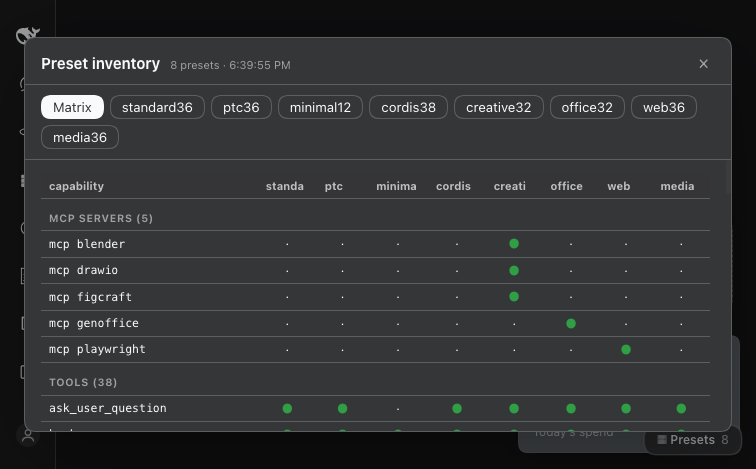

# dsh-preset-inspector

A read-only panel in the DeepSeek Harness Web GUI that answers **"what is actually
inside preset X?"** — and a pair of CLIs that answer the same question from a
terminal, plus one that moves a plugin between presets.



## Why

A DSH profile runs several **agent presets** (Standard, Web, Media, Creative, …).
Each preset declares a complete child plugin list, and those rows decide the tools,
skills and MCP servers a session gets. Three things make that hard to see:

- The GUI picker shows preset **names**, not contents.
- A request header lists tool **names**, not which preset granted them.
- A plugin installed as a **bundle** mounts at host level, so its tools appear in
  *every* preset — silently, and at token cost in every session.

This plugin makes all of it visible, and gives you one command to change it.

## What it shows

- **Matrix** — every capability (tool, conditional tool, MCP server, skill) against
  every preset.
- **Per preset** — tools grouped by the plugin that registers them, conditional
  tools with the reason each is not guaranteed, MCP servers and their endpoints,
  skill roots with counts and names, and every composition row with its state.
- **Live** — the data comes from the running preset registry, so a preset that
  failed to mount shows up with its diagnostic instead of hiding.

## How it works

The host half reads `ctx.agentPresets` — the same registry the GUI picker uses —
flattens each preset's `config.plugins`, resolves every module to its package
directory and attributes the tool names that package registers. Host rows that
register tools are added to every preset, because `ToolRuntime.view(scope)`
inherits ancestor layers.

The browser half is a **client module** (`exports["./client"]`): the host ships the
snapshot as `globalThis.__dshPresets` through a `global` index-injection row, and
the client module renders it. No bundler, no route, no auth work.

## Install

```sh
dsh plugin --profile web add github:anonamerjaxon-dev/dsh-preset-inspector
```

Or from a checkout:

```sh
dsh plugin --profile web add /path/to/dsh-preset-inspector
```

Then add `dsh-preset-inspector` to `dsh.profile.bundles` in
`~/.dsh/profiles/web/package.json` and restart `dsh web`. A **▦ Presets** button
appears at the bottom-right of the GUI.

It registers no tools of its own, so it costs a session nothing in tool schemas.

## CLIs (optional, no install required)

`bin/` carries the terminal side of the same idea. `node bin/dsh-presets` and
`node bin/dsh-preset-plugin`, or symlink them onto your `PATH`.

```
dsh-presets list                 # presets with tool / skill / MCP counts
dsh-presets show creative        # everything in one preset
dsh-presets matrix               # capability × preset grid
dsh-presets diff standard web    # what differs between two presets
dsh-presets json                 # machine-readable snapshot

dsh-preset-plugin list           # every plugin and where it is mounted
dsh-preset-plugin where <plugin> # one plugin, with its row ids
dsh-preset-plugin move <plugin> creative,web   # these presets only
dsh-preset-plugin everywhere <plugin>          # back to every session (default)
dsh-preset-plugin off <plugin>                 # mounted in no preset
```

Both read `dsh --profile <name> --dump-config`, which composes the profile and
exits without binding a port — so they work while a server is running, and they
never touch one.

`dsh-preset-plugin` writes with a backup, recomposes to verify, and rolls back if
the composition fails. A `move` followed by `everywhere` leaves the file
byte-identical.

## Requirements

- DeepSeek Harness `0.2.1-rc.2` (the preset registry API it reads).
- Node `>= 22`.

No runtime dependencies.

## Licence

MIT.
